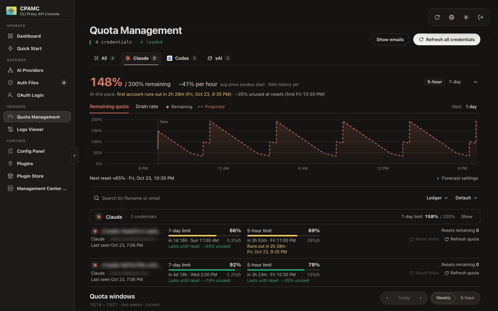

<div align="center">


# CLIProxyAPI Panel

**Know when your Claude and Codex quota runs out before it does.**

A management panel for [CLIProxyAPI](https://github.com/router-for-me/CLIProxyAPI) with quota forecasting,<br>
burn-rate predictions and privacy blur. Ships as a single HTML file.

[](https://github.com/router-for-me/CLIProxyAPI)
[](#install)
[](LICENSE)

</div>



## What it adds

This is a fork of the official [CLI Proxy API Management Center](https://github.com/router-for-me/Cli-Proxy-API-Management-Center). Everything from upstream is still here. On top of it, the Quota page is rebuilt around one question: **at my current pace, when do I run out?**

- **Forecast per provider.** Remaining quota summed across all accounts of a provider (for example `279% / 600%` for six Claude accounts), with a projection that refills at every account's reset.
- **5-hour and 7-day views.** Switch between windows. The panel picks the one closer to running out.
- **Burn rate that works from the first load.** Measured from recorded readings when there is enough history, otherwise estimated from each window's own usage since it opened.
- **Plain-language outlook.** "First account runs out in 2d 1h (Sun, Oct 25, 7:51 PM)" or "Lasts until reset · ~46% unused", per provider and per account.
- **Accounts that are out.** Flagged with when they come back ("out now · back in 2d 1h"), and their pace still counts.
- **Drain rate chart.** Measured rate where history exists, with the window average as a dotted reference line.
- **No extra provider calls.** Reads the passive quota snapshot CLIProxyAPI already keeps from real traffic, polled every 2 minutes while the page is open.
- **Cached on load.** Last known values show immediately, then refresh in the background.
- **Privacy blur.** Emails and account names are blurred by default. Click one to reveal it, or use "Show emails".
- **Ledger view.** One compact row per account, next to the original card grid.

## Install

CLIProxyAPI downloads its panel from a GitHub release. Point it at this repository:

```yaml
management:
  panel-github-repository: "https://github.com/nikuscs/cliproxy-panel"
```

Then open `http://<host>:<port>/management.html` and sign in with your management key.

> [!NOTE]
> Requires CLIProxyAPI 8.0.0 or later. This repository is the UI only; it does not proxy traffic.

To try a build without a release, copy `dist/index.html` over the `management.html` that CLIProxyAPI serves from its `static` folder. Set `disable-auto-update-panel: true` first, or the server may replace it.

## How the forecast works

| Value | How it is calculated |
| --- | --- |
| Remaining | Sum of each account's remaining % for the selected window |
| Burn rate (measured) | First to last reading in each gap-free run of recorded history |
| Burn rate (average) | % used since the window opened ÷ hours elapsed |
| Runs out at | Now + remaining ÷ burn rate, if that comes before the reset |
| Unused at reset | Remaining − burn rate × hours until reset |

History lives only in your browser (IndexedDB, pruned after 30 days). Nothing is sent anywhere except to your own CLIProxyAPI server.

## Development

Requires [Bun](https://bun.sh) 1.3.14.

```bash
bun install
bun run dev        # against a real CLIProxyAPI server
bun run dev:mock   # with a built-in mock server and fake accounts
bun run verify     # tests, lint and build
```

`bun run build` writes a single file to `dist/index.html`. Pushing a `vX.Y.Z` tag runs the release workflow, which publishes it as `management.html`.

## Credits

The forecast design is inspired by a custom CLIProxyAPI quota dashboard shared by [Theo Browne](https://github.com/t3dotgg).

Built on the [CLI Proxy API Management Center](https://github.com/router-for-me/Cli-Proxy-API-Management-Center) by Router-For.ME, for [CLIProxyAPI](https://github.com/router-for-me/CLIProxyAPI). MIT licensed, see [LICENSE](LICENSE).
